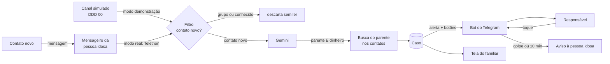

# Guardião da Família

MVP da Global Solution 2026.2 da FIAP (CitizenTech, curso Agentes Inteligentes). Público:
pessoas idosas. ODS 10, meta 10.2.

O Guardião combate o **golpe do falso parente** em mensageiros: uma conta nova diz ser filho
ou neto, diz que trocou de número e pede um Pix urgente a uma pessoa idosa. O golpe depende de
a vítima agir sozinha e com pressa. O Guardião quebra esse isolamento: quando um **número
novo** diz ser parente **e** pede dinheiro, ele avisa pelo Telegram uma **responsável** da
família, com o número verdadeiro do parente salvo nos contatos, a tempo de ela confirmar com
ele antes do Pix. A resposta dela decide o que acontece:

- **É golpe**: a pessoa idosa recebe um aviso calmo para não fazer nenhum Pix agora;
- **Era ele mesmo**: o contato é liberado e deixa de ser analisado;
- **sem resposta em 10 minutos**: a pessoa idosa recebe o aviso.

O agente não responde ao golpista, não bloqueia ninguém, não decide pela pessoa idosa e nunca
pede dinheiro, senha, código ou link. Nada é instalado no celular dela.

## Como a GS é atendida

| Exigência | No Guardião |
|---|---|
| Python | backend inteiro em Python (Flask, Telethon, cliente da Bot API) |
| API de LLM | **Gemini** (Google AI Studio): detecta a alegação de parentesco e o pedido de dinheiro e extrai quem a pessoa diz ser |
| API externa | **Bot API do Telegram**: o sistema consulta a responsável com os botões **É golpe** / **Era ele mesmo**, e a resposta dela muda o desfecho |

## Arquitetura



| Pasta | O que tem |
|---|---|
| `backend/guardiao/canal/` | **camada de canal**, a única que fala com o mensageiro: `telegram.py` (Telethon para ler a conta, Bot API para alertar), `simulado.py` e `cenarios.py` (modo demonstração) e `fabrica.py` (escolhe pelo modo) |
| `backend/guardiao/` | `recepcao.py` (núcleo: conexão, pareamento, eventos), `filtro.py` (contato novo × conhecido, 7 dias de observação), `analise.py` e `gemini.py` (detecção), `busca.py` (número verdadeiro nos contatos), `casos.py` (alerta, toque, prazo, persistência), `cadastro.py` (link de uso único da responsável), `app.py` e `conexao.py` (tela e login por QR), `roteiro.py` (apoio do notebook e conferência do sinal de sucesso) |
| `frontend/` | tela do familiar em HTML, CSS e JS estáticos: QR da conta, QR do bot, lista de casos e o "celular do golpista" do modo demonstração |
| `notebook/guardiao_colab.ipynb` | o MVP em execução, passo a passo, no Google Colab |
| `backend/tests/` | testes automatizados (sem rede) |

Trocar de mensageiro (por exemplo, WhatsApp) é escrever outra implementação da camada de
canal: o resto do backend só usa `receber_mensagens` e `enviar_alerta`.

## Rodar no Google Colab (caminho da entrega)

1. Abra `notebook/guardiao_colab.ipynb` no Colab (pelo GitHub ou enviando o arquivo). O
   notebook acha o código sozinho: pasta já presente, um `.zip` do projeto enviado ao painel
   *Arquivos* ou `git clone` do repositório público.
2. Crie os Secrets no ícone de **chave** da barra lateral e ative *Acesso ao notebook* em cada
   um:

   | Secret | Para quê | Modo |
   |---|---|---|
   | `TELEGRAM_BOT_TOKEN` | o bot do Guardião (criado no @BotFather) | demonstração e real |
   | `GEMINI_API_KEY` | a detecção (Google AI Studio) | demonstração e real |
   | `GEMINI_MODELO` | opcional: outro modelo (padrão `gemini-3.5-flash-lite`) | demonstração e real |
   | `TELEGRAM_API_ID`, `TELEGRAM_API_HASH` | ler a conta de teste pelo Telethon (my.telegram.org) | só real |

3. *Ambiente de execução → Executar tudo*. O roteiro segue o sinal de sucesso:

   | Seção | O que acontece |
   |---|---|
   | 1–5 | código, dependências, Secrets, modo e conexão do Guardião |
   | 6 | a tela do familiar aparece no notebook, com o QR do bot |
   | 7 | a célula espera a responsável ler o QR (ou abrir o link) no Telegram dela e tocar **Iniciar** (até 5 min) |
   | 8 | Filtra: o vizinho Carlos e o grupo são descartados, sem mostrar o texto e sem caso |
   | 9 | Interpreta: o Gemini lê o golpe clássico (diz ser Pedro, neto, e pede Pix) e marca a suspeita |
   | 10 | Confere: o alerta leva o número salvo `+55 00 98765-0003 (salvo como Pedro Neto)` |
   | 11 | Avisa: a célula espera o toque **É golpe** (até 3 min); o caso fica golpe e o aviso aparece no celular simulado da Dona Maria |
   | 12 | teste 1: confere a interpretação, o alerta no bot, o toque e o sinal ("OK" ou o que falhou) |
   | 13 | teste 2: a Júlia diz ser neta e não pede dinheiro; nenhum caso |
   | 14 | teste 3: o bot falha uma vez no cenário do Lucas; nenhum caso fica aberto e o envio volta ao normal |
   | 15 | encerrar: apaga os casos e a sessão do Telethon e desliga a tela |

   Sem Iniciar ou sem toque no prazo, a célula avisa e as seguintes pulam com aviso (nada
   quebra): toque e rode a célula de novo. Para uma apresentação, use *Executar anteriores* na
   célula do Encerrar, para a tela continuar no ar até o fim.

Qualquer pessoa com o token de um bot e uma chave do Gemini repete a demonstração: a conta da
pessoa idosa é simulada.

## Rodar localmente

```bash
cd backend
python3 -m venv .venv
.venv/bin/pip install -r requirements.txt
cp .env.example .env && chmod 600 .env   # preencha as credenciais; o arquivo fica fora do git
.venv/bin/python -m pytest -q            # testes, sem rede
```

Para o notebook, use o `backend/.venv` como kernel (por exemplo, no VS Code ou no Jupyter,
com `ipykernel` instalado nesse ambiente). Fora do Colab, a instalação é pulada, as
credenciais vêm de `backend/.env` e a tela abre no endereço que a seção 6 imprime
(`http://127.0.0.1:5000/`).

## Modos

- **Demonstração (padrão, `MODO = "demonstracao"`):** a conta da Dona Maria é simulada, com
  contatos, conversas antigas e números fictícios com DDD 00 (que não existe no Brasil). O
  Gemini, a busca nos contatos e o bot que alerta a responsável são reais. O aviso à pessoa
  idosa aparece no celular simulado.
- **Real (opcional, `MODO = "real"`):** o Telethon lê uma conta **de teste** do Telegram com
  chip próprio (nunca a conta de uma pessoa real). Sem sessão salva, a tela mostra o QR da
  conta (Telegram → Configurações → Dispositivos → Conectar dispositivo). Conta com
  verificação em duas etapas: faça o login pelo terminal, em `backend/`, com
  `.venv/bin/python -m guardiao.verificar login`. O Encerrar faz o *log out* da conta e apaga
  a sessão.

## Cenários do modo demonstração

| Cenário | O que acontece | Esperado |
|---|---|---|
| `golpe_classico` | número novo: "Oi vó, é o Pedro! Troquei de número" e pede um Pix | alerta com o número do Pedro; "É golpe" avisa a Dona Maria |
| `parente_trocou_numero` | o filho Lucas trocou de número de verdade e pede transferência | alerta; "Era ele mesmo" libera o contato |
| `contato_antigo_pede_dinheiro` | o vizinho Carlos, que já conversava com ela, pede dinheiro | ignorado (conhecido) |
| `mensagem_em_grupo` | alguém no grupo Família pede Pix | ignorado (grupos não são lidos) |
| `contato_novo_sem_dinheiro` | número novo diz ser a neta Júlia e só manda saudades | analisado, sem alerta |

Os cenários também podem ser disparados pela caixa "celular do golpista" da tela.

## Limites e privacidade

- **O que é lido:** só conversas privadas de **contatos novos** (sem conversa antes do
  pareamento), por 7 dias a partir da primeira mensagem. Grupos e conhecidos são descartados
  sem ler o texto.
- **O que vai ao Gemini:** só os textos do contato novo nos últimos 30 minutos. Nenhum
  contato, telefone ou nome da agenda. No nível gratuito, os termos da Gemini API permitem
  que o Google use esse conteúdo para melhorar os produtos: por isso o modo real só roda em
  contas de teste da equipe.
- **O que é guardado:** só o caso (trecho que gerou o alerta, quem a pessoa disse ser, estado,
  resposta e horários) em `backend/.local/casos.json` (modo 600, fora do git), nunca a
  conversa. Os casos são apagados em 30 dias, e o Encerrar apaga tudo.
- **Credenciais:** só nos Secrets do Colab ou em `backend/.env` (fora do git). O notebook
  mostra só *presente/ausente*. A sessão do Telethon é credencial: fica em `backend/.local/`
  (modo 600, fora do git) e é apagada no Encerrar.
- **Logs:** nenhum conteúdo de mensagem; erros registram só o tipo.
- **Fora do MVP:** WhatsApp, conta do parente invadida ou clonada (a mensagem vem do contato
  verdadeiro), ligações, e-mail e SMS, contato automático com o parente, bloqueio de contas,
  responder casos pela tela e operação em produção.
- **Limites conhecidos:** o Telethon só traz os contatos que usam Telegram, com o nome salvo
  no Telegram; o bot só fala com quem tocou Iniciar; o Colab gratuito desliga depois de cerca
  de 90 minutos ocioso; o horário mostrado é o de Brasília (UTC−3).

## Dependências

`backend/requirements.txt`: Telethon 1.45, Flask 3.1, `qrcode[pil]` 8.2, `requests`,
`python-dotenv`, `google-genai` 2.34 e `pytest`. Testado localmente com Python 3.14; no Colab,
o notebook instala tudo no Python do próprio Colab.
Contas: um bot do Telegram (@BotFather), uma chave do Gemini (Google AI Studio) e, só no modo
real, `api_id` e `api_hash` de my.telegram.org e uma conta de teste do Telegram.
